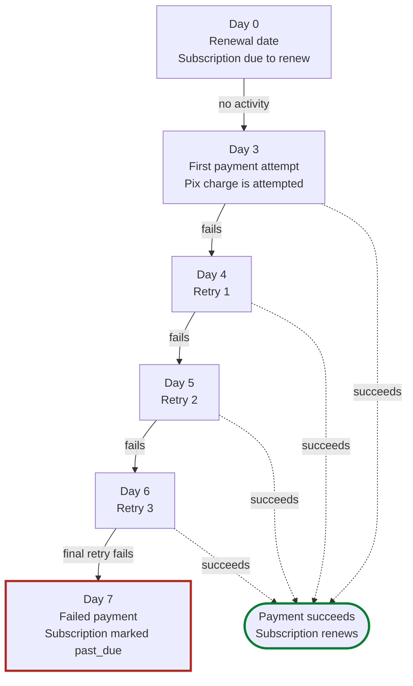

SOURCE https://developer.paddle.com/concepts/payment-methods/pix.md
fetched 2026-11-23
> For the complete documentation index, see [llms.txt](https://developer.paddle.com/llms.txt).
>
> To search these docs, send a `GET` request to `https://paddle-docs-retrieval.kapa-paddle.workers.dev/?q=<question>` with a URL-encoded question. No authentication needed. It returns a JSON array of `{content, source_url}`, most relevant first.

# Pix

Let customers pay with Pix. No configuration required.

---

## Key attributes

| Attribute | Value |
| --- | --- |
| Countries | BR |
| Currencies | BRL |
| Platforms | All |
| One-time items | Supported |
| Subscriptions | Supported |
| Capture | Deferred |
| Chargebacks | Supported |
| Refunds | Supported |
| Installments | Not supported |
| Can be presented when saved? | Not supported |
| Express checkout | Not supported |

Pix is a digital payment method created by the Central Bank of Brazil (BCB) to offer a fast, low cost, and widely accessible way for people in Brazil to make payments. Since its introduction in 2020, it has become Brazil's preferred way to pay and an expectation for Brazilian consumers when paying online.

You can accept Pix for one-time purchases and subscriptions, with payments processed in Brazilian Real.

You don't need to set up a bank account in Brazil or sign up for a Pix merchant account to add Pix as a payment option with Paddle.



Pix is the preferred instant payment method for customers across Brazil.



Pix processed nearly 80 billion transactions in 2025, totaling over R$35 trillion.



Over 90% of the adult population in Brazil actively use Pix.




Pix has a maximum transaction total of 14,000 `BRL`. Paddle additionally limits subscription mandates to 1.5× the non-discounted renewal price, capping the renewal price at approximately 9,333 `BRL`.



Brazil's Imposto sobre Operações Financeiras (IOF) tax applies to Pix payments, paid by the customer. Paddle Checkout informs the customer that IOF applies to the transaction, and the customer sees the amount in the Pix purchase journey before completing the payment.


## How it works




Turn on Pix in a couple of clicks in your Paddle dashboard. Paddle automatically presents Pix as a payment method for customers paying in a supported country and currency.





If the customer is checking out on a desktop, they're prompted to scan a QR code with their phone. If they're on mobile, they're prompted to copy their Pix key and paste it into their banking app manually.





Customer confirms purchase on their phone using their banking app. The exact process varies depending on the banking app the customer uses, but typically they'll authenticate using on-device biometrics.

If the customer is setting up a subscription, they authorize a [Pix Automático](https://www.bcb.gov.br/pix-automatico) subscription mandate that lets Paddle process recurring payments.





Payment is authorized, and Paddle Checkout shows a screen that confirms the checkout is completed, but the payment is pending capture.





After authorization, payment is captured. This typically happens immediately after authorization, but can take up to ten minutes.

The transaction is marked as completed in Paddle, and the customer receives a copy of their invoice by email.




## Things to know

You can accept Pix for subscriptions using [Pix Automático](https://www.bcb.gov.br/pix-automatico), a recurring version of Pix built by the Central Bank of Brazil.

Instead of authorizing a single payment, customers set up a subscription mandate at checkout that lets Paddle collect renewal payments automatically. Pix Automático mandates are set up and managed through the customer's bank.

There are some limitations on how you can use Pix for subscriptions.

### Renewal payments can take up to 7 days

The initial subscription payment is made while the customer is present at checkout, so it's completed quickly. Subscription renewals work differently because the customer isn't present and require advance notice to the customer. The customer receives a predebit notification on the date of each renewal or at the end of a free trial, and the payment is collected 3 days after the notification.

If the initial payment attempt fails, 3 more collection attempts occur over the following 3 days. If all payment attempts fail, the subscription becomes `past_due` on day 7 from the renewal or free trial end date.






To be sure a payment was fully captured, use [webhooks](https://developer.paddle.com/webhooks.md) and wait for [`transaction.completed`](https://developer.paddle.com/webhooks/transactions/transaction-completed.md) to confirm a Pix Automático payment.


### Mid-cycle changes to a subscription

A Pix Automático mandate authorizes a specific charge amount, which Paddle calculates from the non-discounted renewal amount. Once a mandate is in place, Paddle can't charge a different amount, and it can't make immediate, unscheduled charges against the mandate. This impacts how mid-cycle changes to a subscription work, including:

- Plan upgrades and downgrades
- Quantity changes
- Adding or removing a product
- Adding or removing a discount

When you make one of these changes, you should use a next billing period [proration billing mode](https://developer.paddle.com/concepts/subscriptions/proration.md). For example, `prorated_next_billing_period` or `full_next_billing_period`. This applies the change at the next renewal instead of charging immediately.


Immediate proration modes attempt a charge that's considered outside of the mandate, so the payment fails.


The resulting changes to the subscription amount mean that the next renewal fails and the subscription becomes `past_due` because a new mandate authorizing the new amount is required. The customer can [update their payment method](https://developer.paddle.com/build/subscriptions/update-payment-details.md) to authorize a new mandate for the new amount. If you use [Paddle Retain](https://developer.paddle.com/concepts/retain/payment-recovery-dunning.md), payment recovery prompts the customer and recovers the payment for you.

### One-off charges against a subscription aren't supported

Pix Automático mandates don't support one-off charges. This means [billing a one-time charge against a subscription](https://developer.paddle.com/build/subscriptions/bill-add-one-time-charge.md) that's paid using Pix returns a `payment_declined` error.

For a one-off charge, [create a transaction](https://developer.paddle.com/build/transactions/create-transaction.md) for it and [pass it to a checkout](https://developer.paddle.com/build/transactions/pass-transaction-checkout.md). This isn't linked to the customer's existing subscription.

### Daily billing schedules aren't supported

Pix Automático doesn't support subscriptions billed on a daily interval. If a subscription includes a price with a `billing_cycle.interval` of `day`, Paddle doesn't present Pix as a payment method at checkout.

Set the [billing cycle](https://developer.paddle.com/build/products/create-products-prices.md#billing-cycle) to weekly, monthly, quarterly, semi-annual, or annual to keep Pix available as a payment method for the subscription. For example, set `billing_cycle.interval` to `month` and `billing_cycle.frequency` to `3` to collect payments quarterly.
## Accept Pix

1. Go to **Paddle > Checkout > Checkout configuration**.
2. Expand **Payment methods**, then check **Pix**.
3. Click **Save** to apply.

## Test Pix

You can test Pix using your Paddle [sandbox account](https://developer.paddle.com/sdks/sandbox.md).

1. Turn on Pix for your Paddle account.
2. Open a checkout for an item that's priced in `BRL` (Brazilian Real).
3. Pick Brazil as the country on the first screen of checkout, then enter an email.
4. Select Pix as the payment method, then enter a name and CPF or CNPJ tax ID.
5. Click **Pay with Pix** and follow the prompts to complete purchase.

> Paddle Checkout only presents Pix as a payment method for items priced in Brazilian Real, where the customer address is in Brazil.

HTTP 200
